# Walkthrough

A short tour of Garage Desk as it runs on https://garage-desk-tau.vercel.app with the demo data (PRD §8). Screenshots were taken from the live site. Sign-in details for the demo accounts are delivered separately (`CREDENTIALS.local.md`), never in the repo.

## 1. Sign in

Staff sign in with email and password. There is no public sign-up: the owner's and mechanics' accounts are created by the garage. After 10 failed or successful sign-ins from one network in 5 minutes, sign-in pauses briefly (protection against password guessing).

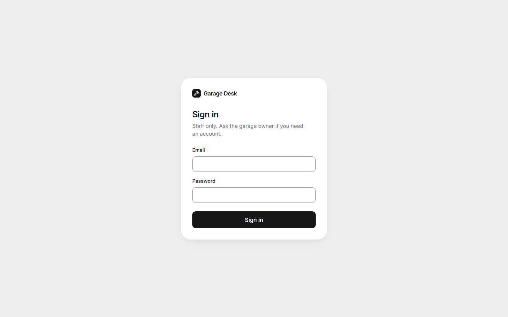

## 2. The owner's dashboard

The owner lands on the dashboard:

- **Revenue this month:** net, excluding VAT, counted in the month a job was collected.
- **Open jobs**, **Awaiting approval** (quotes sent, with declined quotes that need a new one noted underneath) and **Ready for collection**.
- The cars waiting to be collected, and each mechanic's workload.

The sidebar keeps the same counts in view on every page, plus the four most recent jobs.

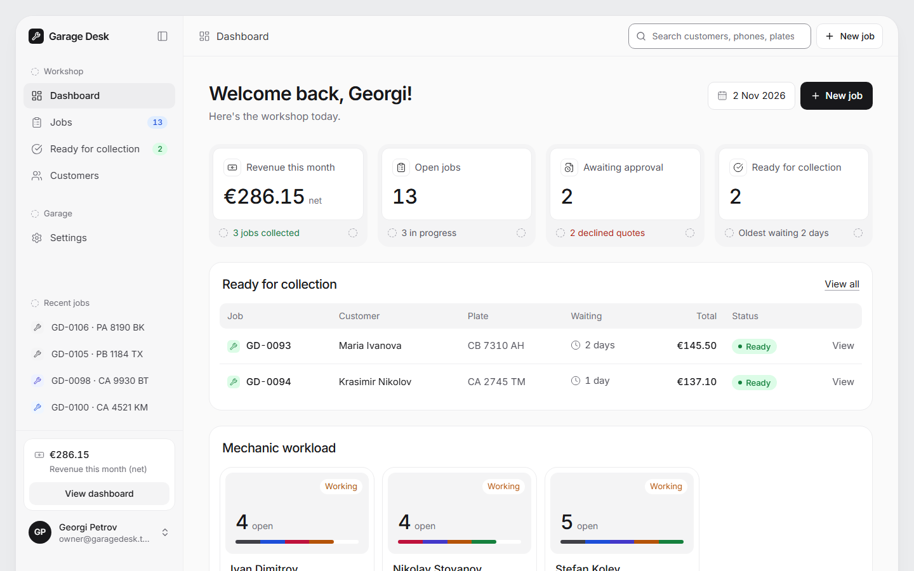

## 3. Jobs

Open jobs by default, with tabs for each status. Each row shows the job number, car, customer, mechanic, status, total and date. The search box at the top finds customers by name, phone or plate.

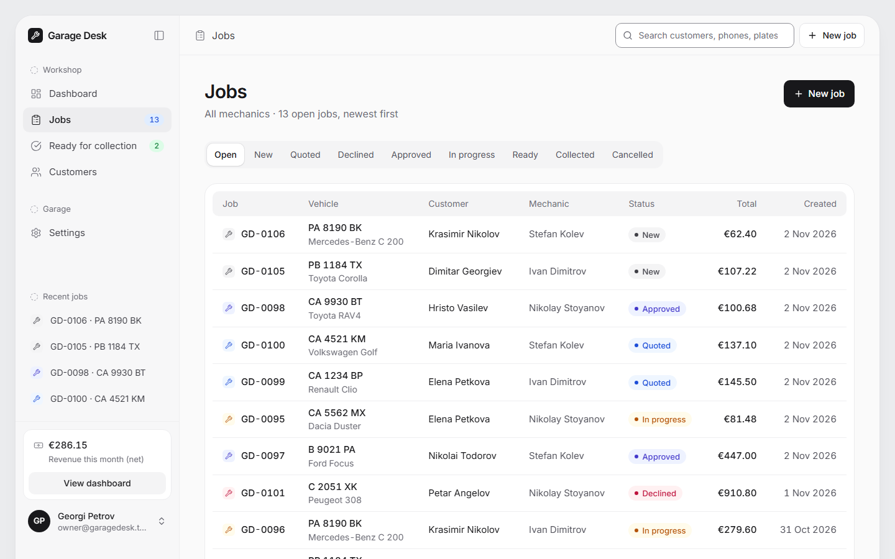

## 4. A new job

Choose the car (or add a new customer and car first), pick the mechanic and describe what needs doing. A job a mechanic creates is assigned to that mechanic. Lines are added on the next screen.

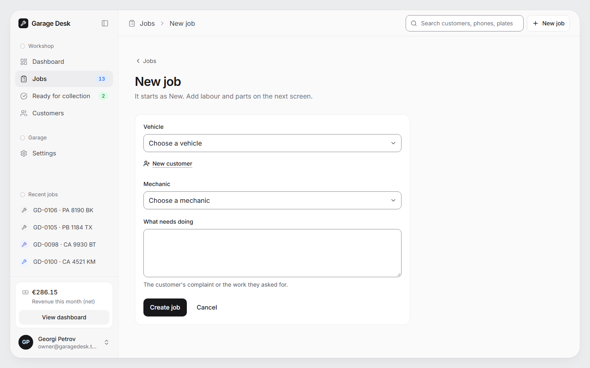

## 5. Quote and customer link

On the job page staff add parts and labour. Labour uses the hourly rate from Settings at the moment the line is added. Lines are stored exactly. VAT is added once on the job total and rounded once to the cent.

**Send quote** freezes the lines as **quote v1**. If anyone changes a line after that, the job goes back to *Quoted* as **v2**, and the customer has to approve the new total. Earlier versions stay visible under *Quote history*.

The **Customer link** panel creates the link that is sent to the customer (for example over WhatsApp). The link can be regenerated or revoked at any time. When the customer agrees by phone, the owner can record it with **Record phone approval** and a short note. The timeline then shows that staff recorded it.

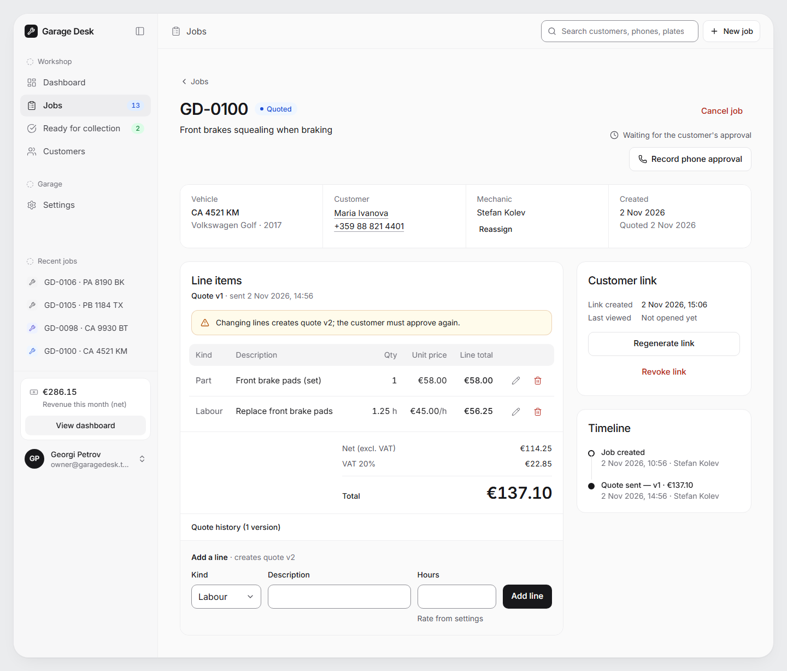

## 6. From approval to collection

After approval: **Start work** → **Mark ready for collection** → **Mark collected**. If a car comes back for rework, the owner or the assigned mechanic moves it from Ready back to In progress with a note. The owner can cancel any job that is not yet collected, but must give a reason.

The timeline records every step: who did it, when, and for approvals which quote version and total were approved.

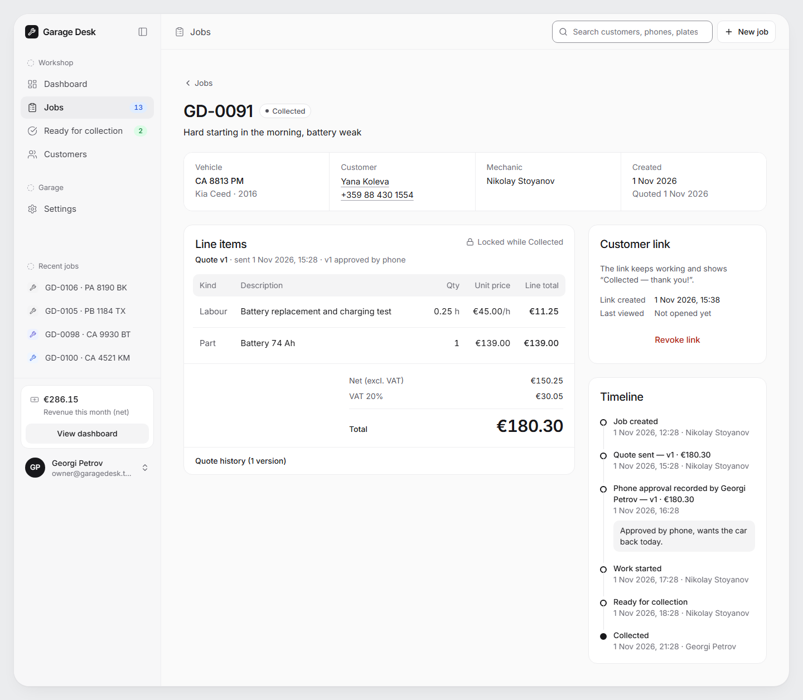

## 7. Customers

Customers and their cars, with each customer's jobs. Phone numbers are shown in the Bulgarian format, and plates as "CA 4521 KM".

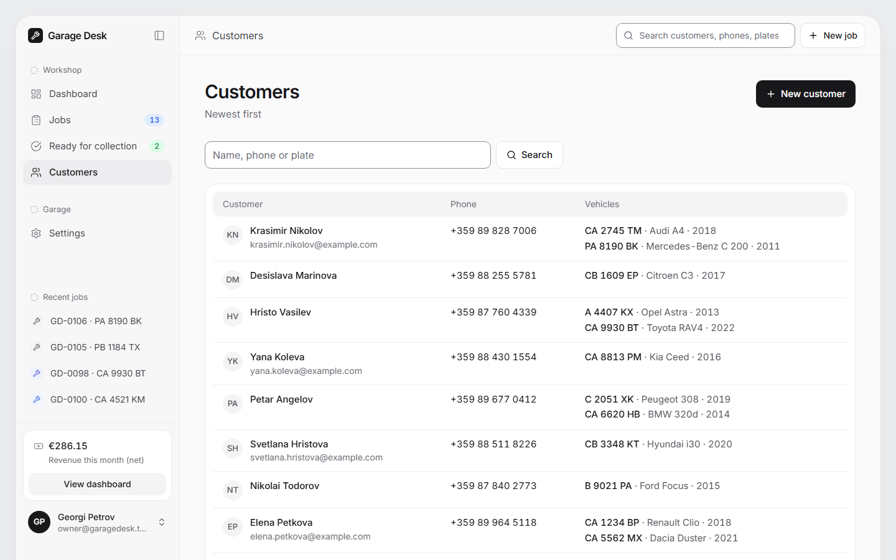

## 8. Settings (owner only)

Hourly rate, VAT rate and garage details. A new rate applies only to labour lines added from now on. A new VAT rate applies only to jobs created from now on. The garage name, address and phone appear on the customer's page.

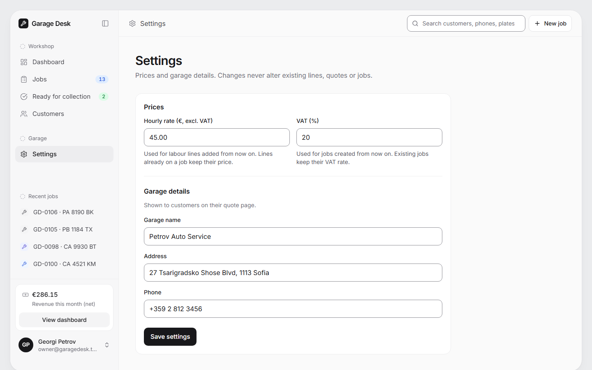

## 9. What a mechanic sees

Mechanics see only their own jobs, plus customers and cars. They can create customers, cars and jobs and work on their jobs. They do not see revenue, other mechanics' jobs or Settings, and those pages answer with the same "Page not found" as any unknown page.

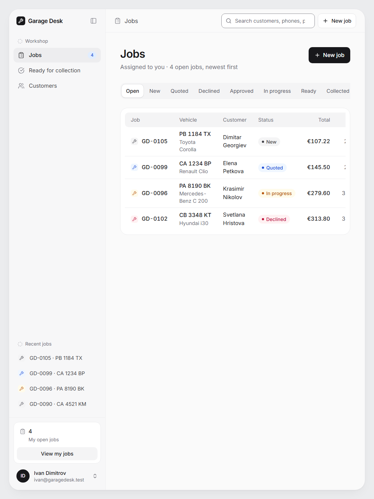

## 10. The customer's phone

The customer opens the link without an account. They see the car, the quote with net, VAT and total, the status, and the progress steps. They do not see their phone number, internal notes or staff names.

While the job is *Quoted* they can **Approve** or **Decline**, with an optional reason for declining. A button pressed on an old version of the quote changes nothing: the page shows the current version instead. After that, the page just shows where the car is.

| Quote waiting for approval | Work in progress | Ready for collection |
|---|---|---|
| 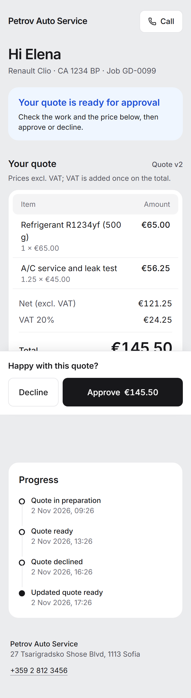 | 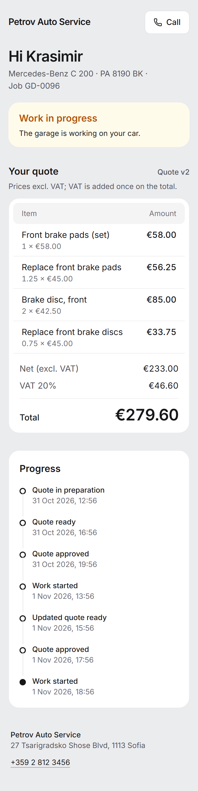 | 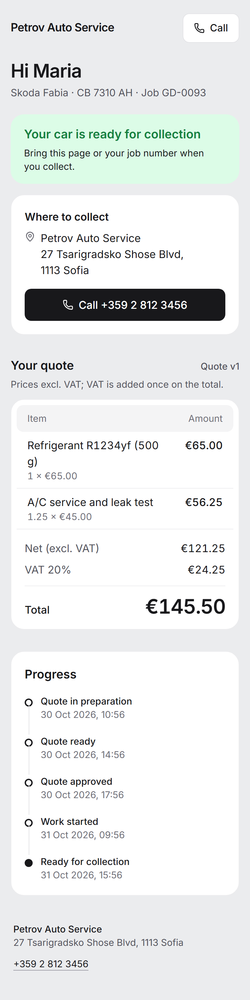 |

The customer pages are designed for a 375px-wide phone first. An unknown, mistyped or revoked link shows the same "Page not found" as any other missing page, so a link cannot be guessed by trying.
