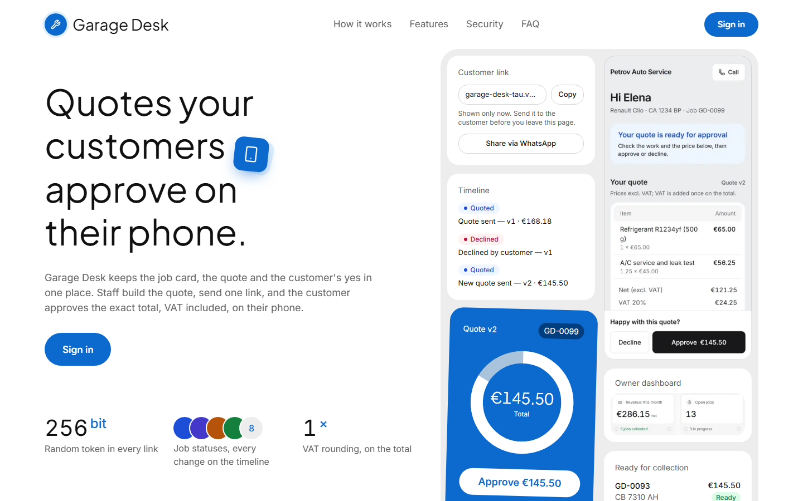
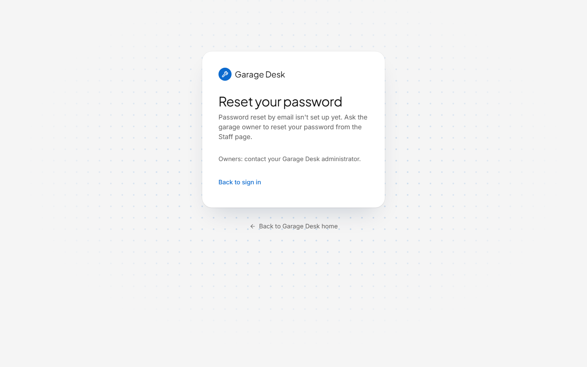
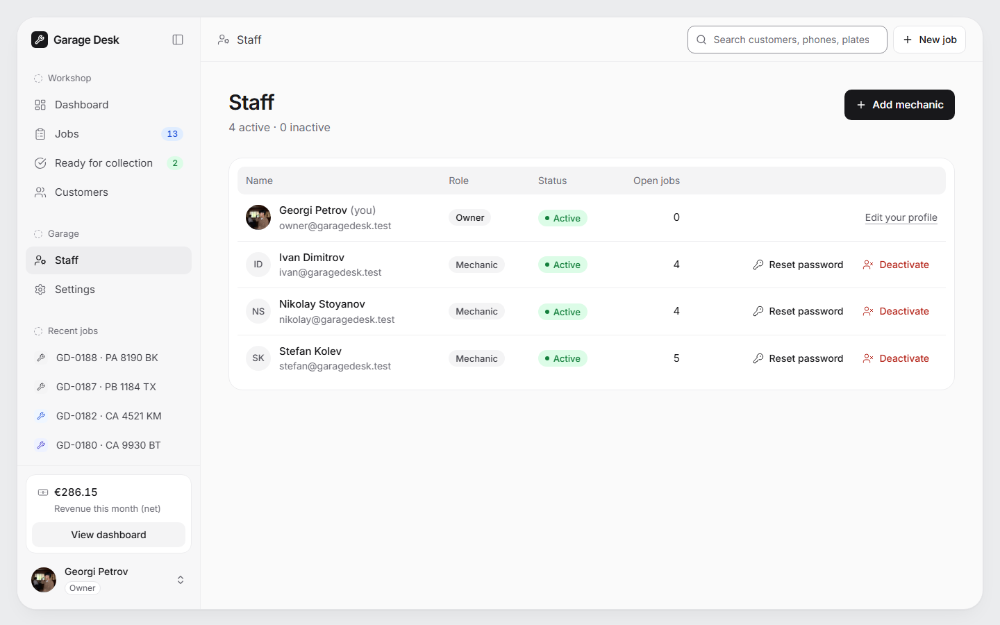
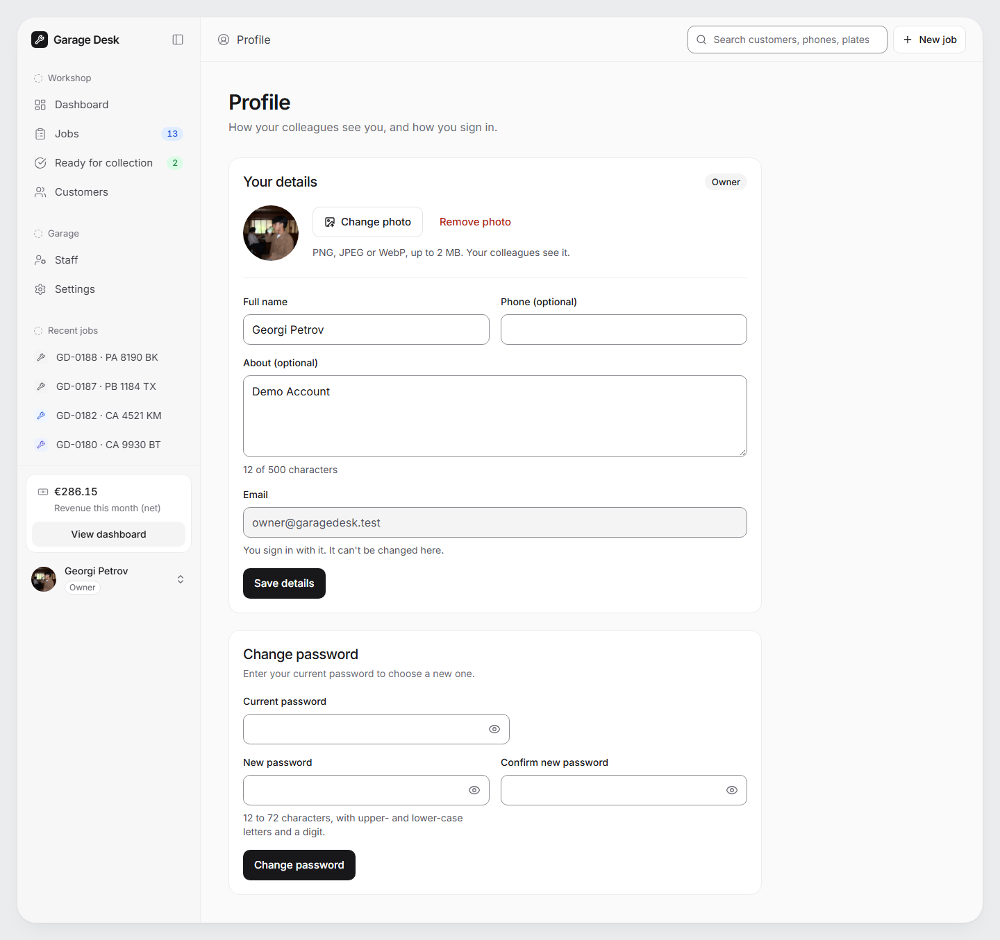

# Walkthrough

A short tour of Garage Desk as it runs on https://garage-desk-tau.vercel.app with the demo data (PRD §8). Screenshots were taken from the live site. Sign-in details for the demo accounts are delivered separately (`CREDENTIALS.local.md`), never in the repo.

## 1. The home page

Anyone can open https://garage-desk-tau.vercel.app. The page explains what Garage Desk does:

- how a job moves from the first call to collection, in six steps;
- the main features;
- a tour of the owner's dashboard, a mechanic's jobs and the customer's phone, using screenshots of the real app with demo data;
- the security rules (link tokens, database rules, frozen quote versions, VAT, roles, rate limits);
- a short FAQ.

Everything on it is true of the product. There are no invented testimonials, customer logos, ratings or prices. The button at the top says **Sign in**. For staff who are already signed in it says **Open app** and takes them to their start page: the dashboard for the owner, the jobs list for a mechanic. This is the only page search engines may index; every other page asks them not to (D-094).

## 2. Sign in, and a forgotten password

Staff sign in with email and password. **Show password** reveals what you typed. There is no public sign-up: the owner adds mechanics on the Staff page (section 10). After 10 sign-in attempts from one network in 5 minutes, sign-in pauses briefly (protection against password guessing). The owner lands on the dashboard, a mechanic on their jobs.

**Forgot password?** sits next to the Password label. Reset by email needs a mail service that production does not have yet (NEXT-STEPS #4). Until then the page shows no form. It tells staff to ask the garage owner to reset their password from the Staff page, and tells owners to contact their Garage Desk administrator.

Once email is set up, the page asks for the email address and always gives the same answer, "If an account exists for that address, we've sent a link…", so it never reveals who has an account. The link works once and expires after an hour. It opens a page for a new password, which lists the password rule (at least 12 characters, with a lowercase letter, an uppercase letter and a digit) and ticks each part off while you type.

## 3. The owner's dashboard

The owner lands on the dashboard:

- **Revenue this month:** net, excluding VAT, counted in the month a job was collected.
- **Open jobs**, **Awaiting approval** (quotes sent, with declined quotes that need a new one noted underneath) and **Ready for collection**.
- The cars waiting to be collected, and each mechanic's workload.

Every card, figure, row and chip opens the jobs list filtered to exactly the jobs it counts. For example, revenue opens this month's collected jobs, and a mechanic's card opens their open jobs (D-090). If a mechanic has been deactivated but still has open jobs, their workload card stays, marked **Inactive · reassign**, so those cars are not forgotten (D-092).

The sidebar keeps the same counts in view on every page, plus the four most recent jobs.

## 4. Jobs

Open jobs by default, with tabs for each status. Each row shows the job number, car, customer, mechanic, status, total and date. The search box at the top finds customers by name, phone or plate.

## 5. A new job

Choose the car (or add a new customer and car first), pick the mechanic and describe what needs doing. A job a mechanic creates is assigned to that mechanic. Lines are added on the next screen.

## 6. Quote and customer link

On the job page staff add parts and labour. Labour uses the hourly rate from Settings at the moment the line is added. Lines are stored exactly. VAT is added once on the job total and rounded once to the cent.

**Send quote** freezes the lines as **quote v1**. If anyone changes a line after that, the job goes back to *Quoted* as **v2**, and the customer has to approve the new total. Earlier versions stay visible under *Quote history*.

The **Customer link** panel creates the link that is sent to the customer (for example over WhatsApp). The link can be regenerated or revoked at any time. When the customer agrees by phone, the owner can record it with **Record phone approval** and a short note. The timeline then shows that staff recorded it.

## 7. From approval to collection

After approval: **Start work** → **Mark ready for collection** → **Mark collected**. If a car comes back for rework, the owner or the assigned mechanic moves it from Ready back to In progress with a note. The owner can cancel any job that is not yet collected, but must give a reason.

The timeline records every step: who did it, when, and for approvals which quote version and total were approved. The name on each step is the one the person had at that moment, so renaming a profile later does not change the history (D-091).

## 8. Customers

Customers and their cars, with each customer's jobs. Phone numbers are shown in the Bulgarian format, and plates as "CA 4521 KM".

## 9. Settings (owner only)

Hourly rate, VAT rate and garage details. A new rate applies only to labour lines added from now on. A new VAT rate applies only to jobs created from now on. The garage name, address and phone appear on the customer's page.

## 10. Staff (owner only)

The owner opens **Staff** in the sidebar. The list shows each person's photo, name, email, role, status (active or deactivated) and number of open jobs.

- **Add mechanic:** enter their name and email. Garage Desk creates the account and shows a temporary password once, in the same dialog, with a Copy button. Share it privately; closing the dialog discards it, and it is never stored. The mechanic then sets their own password on their profile. No two staff members can have the same name, so nobody can pose as a colleague (D-091).
- **Reset password:** gives a mechanic a new temporary password, shown once in the same way. It works only for active mechanics (reactivate first). An owner's password is never reset here: owners change their own on their profile, and an owner who has forgotten it needs the administrator.
- **Deactivate:** for someone who leaves. They are signed out on every device at once and cannot sign in. Their jobs stay assigned to them: the dialog says how many open jobs that is, their row then shows "N open jobs · Reassign", and their dashboard card is marked **Inactive · reassign**. Both lead to their jobs, and the owner reassigns each one from the job page (D-092, D-095).
- **Reactivate:** lets them sign in again. Old sessions do not come back.

Your own row has no buttons; it links to your profile instead. The last active owner cannot be deactivated, so the garage is never left without one. The database enforces both rules, not only the page (D-077, D-084).

A mechanic who opens the Staff page gets the same "Page not found" as any unknown address.

## 11. Your profile (everyone)

Every staff member opens **Profile** from the menu under their name (or from their photo in the top bar on smaller screens).

- **Photo:** PNG, JPEG or WebP, up to 2 MB. You see a preview first; nothing is uploaded until **Save photo**. Without a photo, your initials are shown.
- **Name, phone and "about".** Your email is shown but cannot be changed here.
- **Password:** enter your current password and the new one twice. The same rule applies: at least 12 characters, with a lowercase letter, an uppercase letter and a digit. Changing it signs you out on your other devices.

Colleagues see only your name and photo. Nobody else, the owner included, can read your phone number or "about" text (D-076).

**Sign out** (in the same menu) signs you out on the device you are using. Your other devices stay signed in.

## 12. What a mechanic sees

Mechanics see only their own jobs, plus customers and cars. They can create customers, cars and jobs, work on their jobs, and edit their own profile. They do not see revenue, other mechanics' jobs, Settings or Staff. Those pages answer with the same "Page not found" as any unknown page. Empty lists say so plainly, for example "No open jobs assigned to you", so an empty list is not mistaken for an empty garage.

## 13. The customer's phone

The customer opens the link without an account. They see the car, the quote with net, VAT and total, the status, and the progress steps. They do not see their phone number, internal notes or staff names.

While the job is *Quoted* they can **Approve** or **Decline**, with an optional reason for declining. A button pressed on an old version of the quote changes nothing: the page shows the current version instead. After that, the page just shows where the car is.

| Quote waiting for approval | Work in progress | Ready for collection |
|---|---|---|
|  |  |  |

The customer pages are designed for a 375px-wide phone first. An unknown, mistyped or revoked link shows the same "Page not found" as any other missing page, so a link cannot be guessed by trying. That page suggests asking the garage to send the link again.
